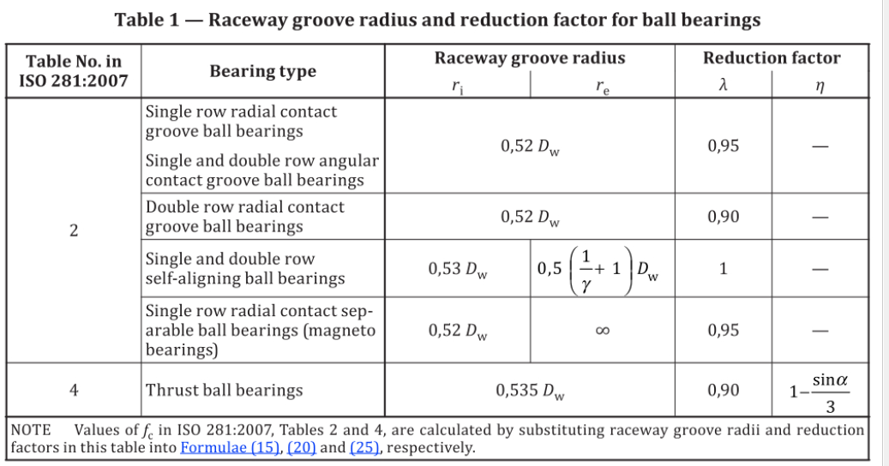

# 角接触球轴承计算

# 需求

## 输入

| 符号      | 含义                                          |
| --------- | --------------------------------------------- |
| $D_w$     | 钢球直径                                      |
| $D_{pw}$  | 节圆直径                                      |
| $Z$       | 钢球数量                                      |
| $\alpha$  | 接触角                                        |
| $F_r$     | 径向力                                        |
| $F_a$     | 轴向力                                        |
| $f_i$     | 内圈沟道曲率系数                              |
| $f_e$     | 外圈沟道曲率系数                              |
| $b_m$     | 动载荷计算系数，球轴承取1.3                   |
| $\lambda$ | 降低系数，深沟球和角接触球取0.95，推力球取0.9 |

## 输出

| 符号     | 含义           |
| -------- | -------------- |
| $C_r$    | 径向额定动载荷 |
| $C_{0r}$ | 径向额定静载荷 |
| $C_{a}$  | 轴向额定动载荷 |
| $C_{0a}$ | 轴向额定静载荷 |
| $L_{10}$ | 额定寿命       |
| $S_0$    | 静载荷安全系数 |
| $P_{0r}$ | 径向当量静载荷 |
| $P_{0a}$ | 轴向当量静载荷 |

## 中间变量名称

| 符号                         | 含义                                                                                |
| ---------------------------- | ----------------------------------------------------------------------------------- |
| $\gamma$                     | $\dfrac{D_w\cos\alpha}{D_{pw}}$                                                     |
| $Q_{ci}$                     | 内圈额定动载荷                                                                      |
| $Q_{co}$                     | 外圈额定动载荷                                                                      |
| $Q_{e\mu}$                   | 动圈当量动载荷                                                                      |
| $Q_{e\nu}$                   | 静圈当量动载荷                                                                      |
| $a$                          | Hertz接触椭圆长半轴                                                                 |
| $b$                          | Hertz接触椭圆短半轴                                                                 |
| $\kappa$                     | $\frac{a}{b}$                                                                       |
| $e$                          | 椭圆离心率$e = \sqrt{1 - \left(\frac{b}{a}\right)^2} = \sqrt{1-\frac{1}{\kappa^2}}$ |
| $F(\rho)$                    | 曲率函数(相对曲率差)                                                                |
| $J_r$                        | 径向载荷分布积分                                                                    |
| $J_a$                        | 轴向载荷分布积分                                                                    |
| $J_1$                        | 动圈平均载荷积分                                                                    |
| $J_2$                        | 静圈平均载荷积分                                                                    |
| $f_c$                        | 国标动载荷系数                                                                      |
| $f_0$                        | 国标静止载荷系数                                                                    |
| $\varepsilon$                | 载荷分布系数， 等于0.5 半圈接触， 大于1.0 完全接触                                  |
| $\psi$                       | 方位角                                                                              |
| $\Gamma(e), K(e), K(\kappa)$ | 第一类完全椭圆积分                                                                  |
| $\Pi(e), E(e), E(\kappa)$    | 第二轮完全椭圆积分                                                                  |

# 计算过程

## 径向额定动载荷$Cr$

$$
\begin{cases}
C_\mathrm{r}=f_\mathrm{c}(i\cos\alpha)^{0.7}Z^{2/3}D_\mathrm{w}^{1.8} & (D_\mathrm{w}\le 25.4\ \mathrm{mm}) \\
C_\mathrm{r}=3.647f_\mathrm{c}(i\cos\alpha)^{0.7}Z^{2/3}D_\mathrm{w}^{1.4} & (D_\mathrm{w}> 25.4\ \mathrm{mm})
\end{cases}
$$

$f_c$按照下式计算

$$
f_\mathrm{c} = 0.089\, A_1\, 0.41\, \lambda
\left(\dfrac{2 r_\mathrm{i}}{2 r_\mathrm{i} - D_\mathrm{w}}\right)^{0.41}
\dfrac{\gamma^{0.3}(1-\gamma)^{1.39}}{(1+\gamma)^{1/3}} \times \\
\left[
1+\left\{
1.04
\left[
\dfrac{r_\mathrm{i}}{r_\mathrm{e}}
\left(\dfrac{2 r_\mathrm{e}-D_\mathrm{w}}{2 r_\mathrm{i}-D_\mathrm{w}}\right)
\right]^{0.41}
\left(\dfrac{1-\gamma}{1+\gamma}\right)^{1.72}
\right\}^{10/3}
\right]^{-3/10}
$$

其中：

$$
\begin{align*}
0.089A_1 &= 98.0665 \\
\gamma & = \frac{D_w\cos\alpha}{D_{pw}}
\end{align*}
$$

化简为不含$D_w$的形式

$$
f_\mathrm{c} = 0.089\, A_1\, 0.41\, \lambda
\left(\dfrac{2 f_\mathrm{i}}{2 f_\mathrm{i} - 1}\right)^{0.41}
\dfrac{\gamma^{0.3}(1-\gamma)^{1.39}}{(1+\gamma)^{1/3}} \times \\
\left[
1+\left\{
1.04
\left[
\dfrac{f_\mathrm{i}}{f_\mathrm{e}}
\left(\dfrac{2 f_\mathrm{e}- 1}{2 f_\mathrm{i}- 1}\right)
\right]^{0.41}
\left(\dfrac{1-\gamma}{1+\gamma}\right)^{1.72}
\right\}^{10/3}
\right]^{-3/10}
$$

其余参数按照**表1**

表 1 ISO 281:2007中的球轴承计算系数

## 径向额定静载荷$C_{0r}$

$$
C_{0r}=f_0 Z D^{2} \red{cos\alpha}
$$

其中$f_0$按照如下公式计算

$$
f_0 = 2.072\left(\dfrac{\sigma_{\mathrm{max}}}{4000}\right)^{\!3}
\kappa
\left(
\dfrac{E(\kappa)}
{2 \pm \dfrac{\gamma}{1 \mp \gamma} - \dfrac{1}{2 f_{\color{red}\mathrm{i(e)}}}}
\right)^{\!2}
$$

其中上面的符号是内圈，下面的符号是外圈，应分别计算取较小的值

$$
\begin{align*}    \sigma_{max} & = 4200 Mpa \\    \gamma & = \frac{D_w\cos\alpha}{D_{pw}} \\ \kappa &= \frac{a}{b} = \frac{a^*}{b^*} \end{align*}
$$

$E(\kappa)$为第二类完全椭圆积分, $a$ 和 $b$ 分别为Hertz接触椭圆的长半轴和短半轴，相关计算方法参考载荷分布部分

## 轴向额定动载荷$C_{a}$

$$
\begin{cases}
C_\mathrm{a}=f_\mathrm{c}(\cos\alpha)^{0.7}\tan\alpha\,Z^{2/3}D_\mathrm{w}^{1.8} & (D_\mathrm{w}\le 25.4\ \mathrm{mm}) \\
C_\mathrm{a}=3.647f_\mathrm{c}(\cos\alpha)^{0.7}\tan\alpha\,Z^{2/3}D_\mathrm{w}^{1.4} & (D_\mathrm{w}> 25.4\ \mathrm{mm})
\end{cases}
$$

$f_c$按照下式计算

$$
f_\mathrm{c}=0.089\, A_1\, \lambda\eta
\left(\dfrac{2 r_\mathrm{i}}{2 r_\mathrm{i}-D_\mathrm{w}}\right)^{0.41}
\dfrac{\gamma^{0.3}(1-\gamma)^{1.39}}{(1+\gamma)^{1/3}} \times
\left[
1+\left\{
\left[
\dfrac{r_\mathrm{i}}{r_\mathrm{e}}
\left(\dfrac{2 r_\mathrm{e}-D_\mathrm{w}}{2 r_\mathrm{i}-D_\mathrm{w}}\right)
\right]^{0.41}
\left(\dfrac{1-\gamma}{1+\gamma}\right)^{1.72}
\right\}^{10/3}
\right]^{-3/10}
$$

其中：

$$
\begin{align*}    0.089A_1 &= 98.0665 \\     \gamma & = \frac{D_w\cos\alpha}{D_{pw}}\end{align*}
$$

其余参数按照**表1**

化简为不含$D_w$的形式

$$
f_\mathrm{c}=0.089\, A_1\, \lambda\eta
\left(\dfrac{2 f_\mathrm{i}}{2 f_\mathrm{i}-1}\right)^{0.41}
\dfrac{\gamma^{0.3}(1-\gamma)^{1.39}}{(1+\gamma)^{1/3}} \times
\left[
1+\left\{
\left[
\dfrac{f_\mathrm{i}}{f_\mathrm{e}}
\left(\dfrac{2 f_\mathrm{e}- 1}{2 f_\mathrm{i}- 1}\right)
\right]^{0.41}
\left(\dfrac{1-\gamma}{1+\gamma}\right)^{1.72}
\right\}^{10/3}
\right]^{-3/10}
$$

## 轴向额定静载荷$C_{0a}$

$$
C_{0a}=f_0 Z D^{2} \sin\alpha
$$

其中$f_0$按照如下公式计算

$$
f_0 = 10.362\left(\dfrac{\sigma_{\mathrm{max}}}{4000}\right)^{\!3}
\kappa
\left(
\dfrac{E(\kappa)}
{2 \pm \dfrac{\gamma}{1 \mp \gamma} - \dfrac{1}{2 f_{\color{red} \mathrm{i(e)}}}}
\right)^{\!2}

$$

其中上面的符号是内圈，下面的符号是外圈，应分别计算取较小的值

$$
\begin{align*}    \sigma_{max} & = 4200 Mpa \\    \gamma & = \frac{D_w\cos\alpha}{D_{pw}} \\ \kappa &= \frac{a}{b} \end{align*}
$$

$E(\kappa)$为第二类完全椭圆积分, $a$ 和 $b$ 分别为Hertz接触椭圆的长半轴和短半轴

当接触角度$\alpha = 90 \degree$时

$$
f_c=0.089\, A_1 \lambda \eta \left(\frac{2r_i}{2r_i-D_w}\right)^{0.41} \gamma^{0.3} \left[ 1+\left\{ \left[ \frac{r_i}{r_e}\left(\frac{2r_e-D_w}{2r_i-D_w}\right) \right]^{0.41} \right\}^{10/3} \right]^{-3/10}
$$

## 计算当量动载荷

$$
P = X F_r+YF_a
$$

$X$和$Y$系数GB/T 6391 查表或者根据ISO/TR 1281-1 - 2021中7 部分计算。

## 计算当量静载荷

$$
P_0 = X_0 F_r+Y_0F_a
$$

$X_0$和$Y_0$系数根据GB/T 4662 查表或者根据ISO/TR 10657 - 2021中5.5.1.2 部分计算

**$P_{0r}$计算**

根据《球轴承设计计算》式(9-4)到式(9-6)

$$
Q_{max} = \frac{F_r}{Z\cos\alpha Jr(\varepsilon)} = \frac{F_a}{Z\sin\alpha Ja(\varepsilon)} = \frac{P_{0r}}{Z\cos\alpha J_r(0.5)}
$$

可得

$$

P_{0r} = \frac{F_rJ_r(0.5)}{J_r(\varepsilon)} =\frac{F_aJ_r(0.5)}{J_a(\varepsilon)\tan\alpha}

$$

**$P_{0a}$计算**

根据根据《球轴承设计计算》式(9-12）

$$
Q_{max} = \frac{F_r}{Z\cos\alpha Jr(\varepsilon)} = \frac{F_a}{Z\sin\alpha Ja(\varepsilon)} = \frac{P_{0a}}{Z\sin\alpha}
$$

可得

$$

P_{0a} = \frac{F_r\tan\alpha}{J_r(\varepsilon)} =\frac{F_a}{J_a(\varepsilon)}

$$

**注：与国标计算方法不同，需要验证！式子中的$\varepsilon$计算方法见载荷分布部分 , 特别是$0<\varepsilon<0.5$时，计算出入较大(正常预紧有效的情况下$\varepsilon \geq 0.5$)。**

## 根据LP理论计算$L_{10}$

$$
L_{10} = \left( \frac{P}{Cr} \right) ^ {3}
$$

单个套圈的额定动载荷

$$

Q_c = 98.1 \left( \frac{f}{2f-1} \right)^{0.41} \frac{(1\mp\gamma)^{1.39}}{(1\pm\gamma)^{\frac13}} \left( \frac{\gamma}{\cos\alpha} \right)^{0.3} D^{1.8} Z^{-\frac13}

$$

其中上面符号用于内圈，下面符号用于外圈

实际计算

$$
Q_c=b_m\lambda\eta Q_c
$$

其中$b_m$是材料系数，球轴承取1.3，$\lambda, \eta$取值见表1

平均载荷

动圈

$$
\begin{align*}
Q_{\mathrm{e\mu}} &= Q_{\mathrm{max}}
\left\{
\frac{1}{2\pi}
\int_{-\psi_1}^{+\psi_1}
\left[
1-\frac{1}{2\varepsilon}(1-\cos\psi)
\right]^{4.5}
\mathrm{d}\psi
\right\}^{1/3} \\
&= Q_{max}J_1
\end{align*}

$$

静圈

$$
\begin{align*}

Q_{\mathrm{e\nu}} &= Q_{\mathrm{max}}
\left\{
\frac{1}{2\pi}
\int_{-\psi_1}^{+\psi_1}
\left[
1-\frac{1}{2\varepsilon}(1-\cos\psi)
\right]^{5}
\mathrm{d}\psi
\right\}^{0.3} \\ &= Q_{max}J_2

\end{align*}

$$

其中$J_1$,$J_2$分布是动圈和静圈的平均载荷积分

内圈为动圈，外圈为静圈则

内圈寿命为

$$
L_{i} = \left(\frac{Q_{ci}}{Q_{e\mu}}\right)^3
$$

外圈寿命为

$$
L_{o} = \left(\frac{Q_{co}}{Q_{e\nu}}\right)^3
$$

轴承综合寿命为

$$
L_{10}=\left(L_i^{-\frac{10}{9}} + L_o^{-\frac{10}{9}}\right)^{-\frac{9}{10}}
$$

## 载荷分布

1. 根据下式子计算出$\textcolor{red}{\varepsilon, J_r(\varepsilon), J_a(\varepsilon)}$，或者查表《滚动轴承分析》第一卷 表7.4

$$
\frac{F_r\tan\alpha}{F_a} = \frac{J_r(\varepsilon)}{J_a(\varepsilon)}
$$

其中

$$
\begin{align*}
J_r(\varepsilon) &= \frac{1}{2\pi}\int_{-\psi_l}^{+\psi_l}
\left[1-\frac{1}{2\varepsilon}\bigl(1-\cos\psi\bigr)\right]^{1.5} \cos\psi \,d\psi \\
J_a(\varepsilon) &= \frac{1}{2\pi}\int_{-\psi_l}^{+\psi_l}
\left[1-\frac{1}{2\varepsilon}\bigl(1-\cos\psi\bigr)\right]^{1.5} d\psi
\end{align*}
$$

1. 根据下式计算出$Q_{max}$

$$
Q_{max} = \frac{F_r}{J_r(\varepsilon)Z \color{red}\cos\alpha}
$$

或

$$
Q_{max} = \frac{F_a}{J_a(\varepsilon)Z\sin\alpha}
$$

上面两个式子计算结果应相同

1. 计算方位角$\psi$处的钢球受力

$$
Q_\psi = Q_{max}\left[1 - \frac{1}{2\varepsilon}(1-\cos\psi)\right]^{1.5}
$$

1. 根据Hertz理论计算计算每个方位角$\psi$处接触椭圆长半轴$a_\psi$, 短半轴$b_\psi$，及接触应力$\sigma_\psi$

$$
\begin{align*}
a_\psi &= a^{*}\left[\frac{3Q_{\psi}}{2\sum\rho}\left(\frac{(1-\xi_{\text{I}}^{2})}{E_{\text{I}}}+\frac{(1-\xi_{\text{II}}^{2})}{E_{\text{II}}}\right)\right]^{\frac{1}{3}} \\
  &= 0.023\,6\,a^{*}\left(\frac{Q_{\psi}}{\sum\rho}\right)^{\frac{1}{3}} \quad(\text{对钢材}) \\[6pt]
b_\psi &= b^{*}\left[\frac{3Q_{\psi}}{2\sum\rho}\left(\frac{(1-\xi_{\text{I}}^{2})}{E_{\text{I}}}+\frac{(1-\xi_{\text{II}}^{2})}{E_{\text{II}}}\right)\right]^{\frac{1}{3}} \\
  &= 0.023\,6\,b^{*}\left(\frac{Q_{\psi}}{\sum\rho}\right)^{\frac{1}{3}} \quad(\text{对钢材}) \\[8pt]
\sigma_\psi &= \frac{3Q_{\psi}}{2\pi a_\psi b_\psi} \left[ 1-\left( \frac{x}{a_\psi} \right)^{\!2} - \left( \frac{y}{b_\psi} \right)^{\!2} \right]^{\frac12}
\end{align*}
$$

每个方位角$\psi$处最大接触应力发生在$x = 0, y = 0$处

$$
\sigma_{\psi max} = \frac{3Q_\psi}{2\pi a_{\psi}b_{\psi}}
$$

其中$a^*$,$b^*$根据曲率函数$F(\rho)$查表，或者根据下式计算先求解出椭圆离心率$e$

$$
\begin{align*}
\cos\theta = F(\rho) &= \frac{A-B}{A+B} \\
&= \frac{\rho_{\text{I}1}-\rho_{\text{II}1}+\rho_{\text{I}2}-\rho_{\text{II}2}}{\sum\rho} \\
&= 1-\frac{2(1-e^2)}{e^2}\frac{\Gamma(e)-\Pi(e)}{\Pi(e)}
\end{align*}
$$

其中$e$为椭圆离心率$e=\sqrt{1 - \dfrac{b^2}{a^2}}$, $\Gamma(e)$和$\Pi(e)$分别是第一类完全椭圆积分和第二类完全椭圆积分

再根据下式计算

$$
\begin{align*}
a^{*} &= \left(\frac{2\Pi(e)}{\pi\left(1-e^{2}\right)}\right)^{1/3} \\
b^{*} &= \left(\frac{2\sqrt{1-e^{2}}\,\Pi(e)}{\pi}\right)^{1/3}
\end{align*}
$$

## 内外圈曲率和$\sum\rho_\mathrm{i}$和曲率差$F(\rho)$计算

### 定**义**

曲率和

$$
\sum \rho = \frac{1}{r_{\mathrm{I1}}} + \frac{1}{r_{\mathrm{I2}}} + \frac{1}{r_{\mathrm{II1}}} + \frac{1}{r_{\mathrm{II2}}}
$$

曲率差

$$
F(\rho) = \frac{(\rho_{\mathrm{I1}}-\rho_{\mathrm{I2}})+(\rho_{\mathrm{II1}}-\rho_{\mathrm{II2}})}{\sum \rho}
$$

### **计算**

**内圈**

$$
\begin{aligned}\sum \rho_{\mathrm{i}} &= \frac{4}{D}-\frac{1}{f_{\mathrm{i}}D}+\frac{2}{D}\left(\frac{\gamma}{1-\gamma}\right)= \frac{1}{D}\left(4-\frac{1}{f_{\mathrm{i}}}+\frac{2\gamma}{1-\gamma}\right) \\[6pt]F(\rho)_{\mathrm{i}} &= \frac{\displaystyle \frac{2}{D}\left(\frac{\gamma}{1-\gamma}\right)-\left(-\frac{1}{f_{\mathrm{i}}D}\right)}{\displaystyle \sum \rho_{\mathrm{i}}}= \frac{\displaystyle \frac{1}{f_{\mathrm{i}}}+\frac{2\gamma}{1-\gamma}}{\displaystyle 4-\frac{1}{f_{\mathrm{i}}}+\frac{2\gamma}{1-\gamma}}\end{aligned}
$$

**外圈**

$$
\begin{aligned}\sum \rho_{\mathrm{o}} &= \frac{1}{D}\left(4-\frac{1}{f_{\mathrm{o}}}-\frac{2\gamma}{1+\gamma}\right) \\[8pt]F(\rho)_{\mathrm{o}} &= \frac{\displaystyle \frac{1}{f_{\mathrm{o}}}-\frac{2\gamma}{1+\gamma}}{\displaystyle 4-\frac{1}{f_{\mathrm{o}}}-\frac{2\gamma}{1+\gamma}}\end{aligned}
$$

其中

$$
\gamma = \frac{D\cos\alpha}{d_m}
$$
